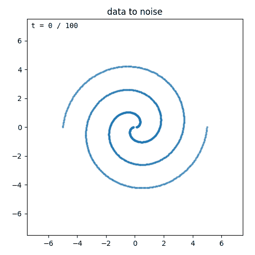
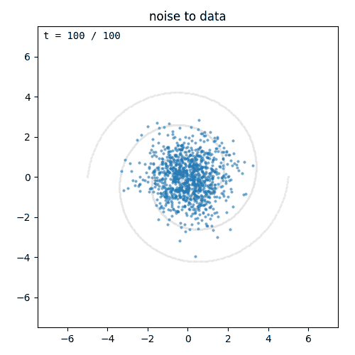
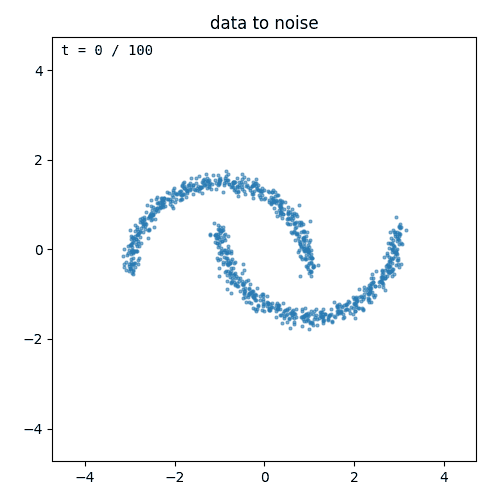
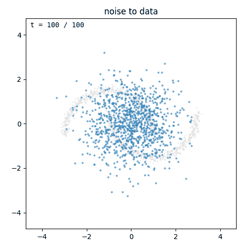
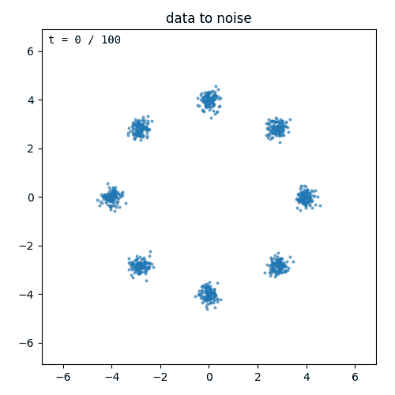
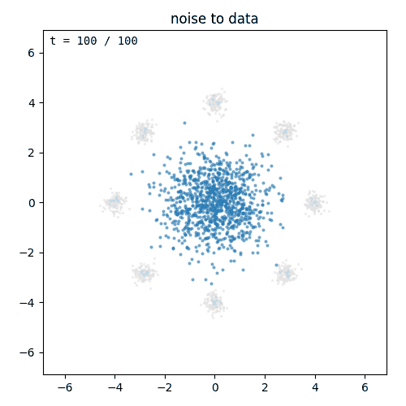

# DDPM
This project implements the forward and reverse algorithm proposed in [Denoising Diffusion Probabilistic Models
](https://arxiv.org/abs/2006.11239). Further two noise estimation models are implemented, one is based on [ResNets](https://arxiv.org/abs/1512.03385) and the other 
is based on [U-Nets](https://arxiv.org/abs/1505.04597).

### Examples
The following animations illustrate the forward and reverse process. 

<table>
  <tr>
    <th></th>
    <th>data to noise</th>
    <th>noise to data</th>
  </tr>
  <tr>
    <td><b>Spiral</b> <a href="experiments/spiral/output/samples.png">samples</a></td>
    <td></td>
    <td></td>
  </tr>
  <tr>
    <td><b>Moons</b> <a href="experiments/moons/output/samples.png">samples</a></td>
    <td></td>
    <td></td>
  </tr>
  <tr>
    <td><b>Gaussians</b> <a href="experiments/gaussians/output/samples.png">samples</a></td>
    <td></td>
    <td></td>
  </tr>
</table>

Each animation follows the same 1000 data points: the forward process noises them step by step, the reverse
process denoises exactly these noised points again with the trained MLP. The light gray points show the data.
The animations are created with `python -m experiments.<spiral|moons|gaussians>.animate`.

